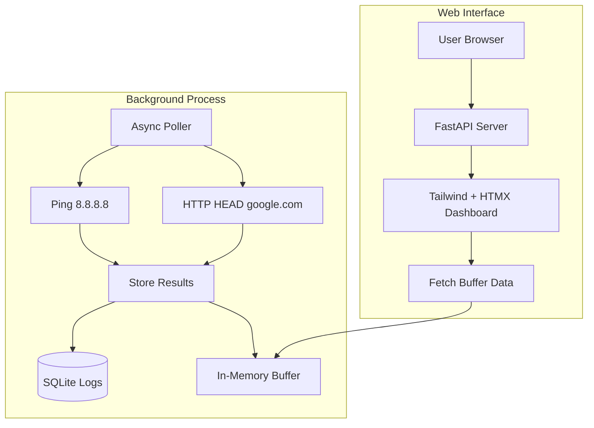

# Plan: Connectivity Monitor Utility

## Overview
A Python-based utility to monitor internet stability, specifically targeting sporadic connection drops (like those affecting MS Teams). It uses a background worker to poll high-availability targets and exposes a real-time dashboard via FastAPI and Tailwind CSS.

## Architecture
- **Backend**: FastAPI (Async)
- **Monitoring**: `aiodns` for DNS health or `asyncio` subprocess for `ping`. 
- **Strategy**: 
    - Secondary check via HTTP HEAD requests to avoid ICMP-only blocking.
    - Multiple targets (Google 8.8.8.8, Cloudflare 1.1.1.1, and a reliable web endpoint like `google.com`).
- **Data Store**: Circular buffer (in-memory) for the last 3600 points (1 hour at 1s intervals) + SQLite for persistent logs of downtime events.
- **Frontend**: FastAPI Templates (Jinja2) + Tailwind CSS + HTMX (for auto-refreshing stats/graphs).

## System Workflow

## Configuration Schema
Configurable via `.env` or `config.yaml`:
- `POLL_INTERVAL`: Default `1.0` (seconds)
- `TARGETS`: List of IPs/Domains
- `TIMEOUT`: Default `0.5` seconds
- `RETENTION_PERIOD`: How long to keep detailed logs (days)

## Robustness Measures
- **Avoid Blacklisting**: Randomized headers for HTTP checks. 
- **Efficiency**: Use `asyncio` to ensure the UI remains responsive while polling.
- **Accuracy**: Distinguish between "DNS Failure", "Packet Loss", and "High Latency".

## Next Steps
1. Initialize FastAPI project structure.
2. Implement the `Monitor` class using `asyncio`.
3. Create the Tailwind-based dashboard layout.
4. Integrate HTMX for real-time chart updates.

---
**Requesting Mode Switch**: `fitbitter_code`
